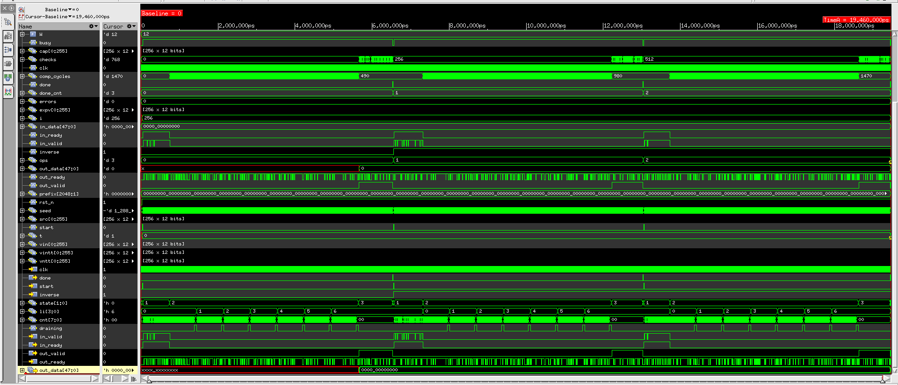
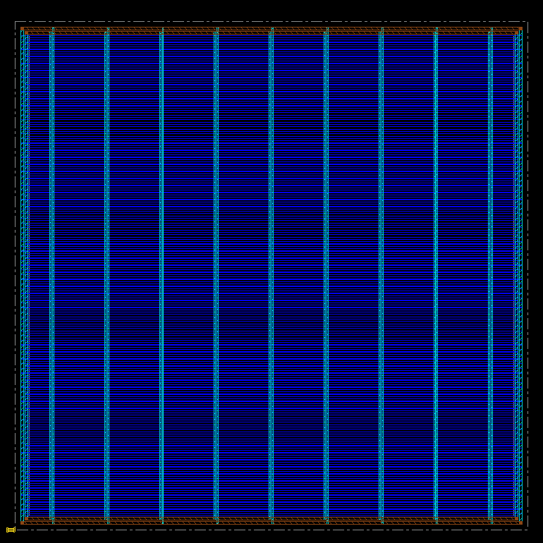
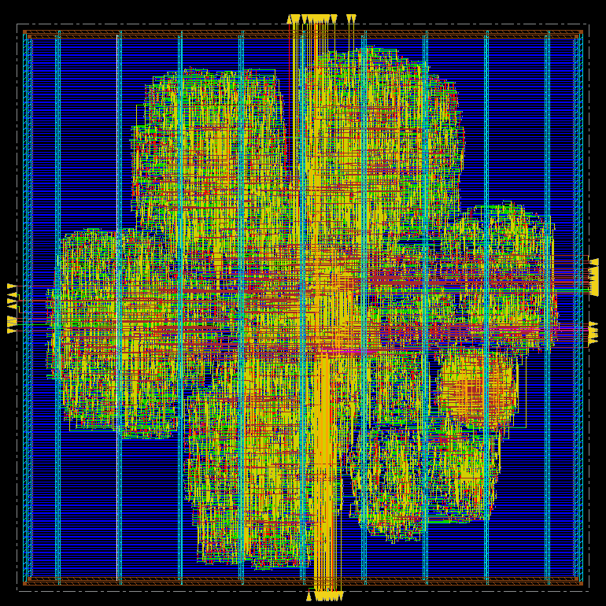
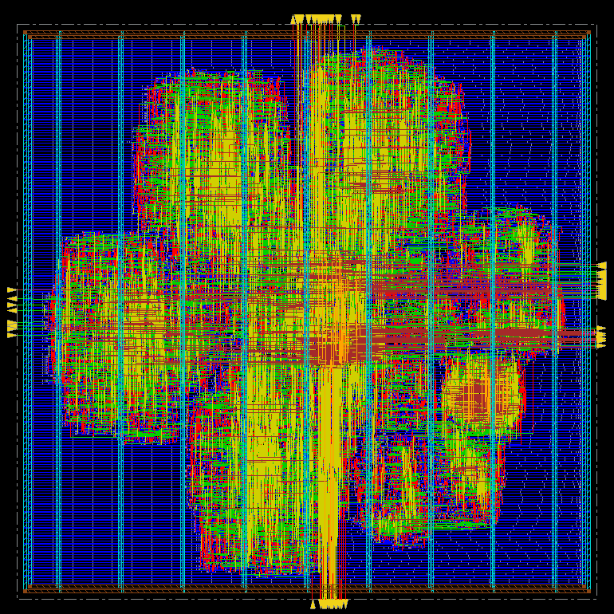

# Lab results: Kyber, Barrett, P = 2, 45 nm (13 Oct 2026)

Configuration: `SCHEME=0` (Kyber, q = 3329), `RED=0` (Barrett), `P=2` (2 butterflies, 4 banks),
3.0 ns clock (333 MHz). Library: Cadence 45 nm GPDK045 training library (`gsclib045`),
slow corner (1.08 V) for setup, fast corner for hold. Tools: Xcelium 24.09, Genus 21.14,
Innovus 21.15.

## 1. RTL simulation (Xcelium)

| Check | Result |
|---|---|
| Forward NTT, round trip (INTT of DUT output), inverse NTT, with random valid/ready stalls | **0 errors** |
| Coefficients compared (1-polynomial GUI run) | 768 / 768 |
| Compute cycles per transform | **490**, exactly the model's prediction (3 transforms = 1470) |

## 2. Synthesis (Genus, slow corner, 3.0 ns)

| Metric | Value |
|---|---|
| Cells | 13,374 (3,618 sequential, 6,933 logic, 2,823 inverters) |
| Worst setup slack | **+7 ps**, 0 violating paths |
| Power estimate (Genus, default activity) | 33.6 mW |

Critical path: bank-select/address register → bank crossbar → modular add/subtract in
butterfly stage 1 → stage-1 register. That is the memory crossbar, not the modular multiplier.

## 3. Place and route (Innovus)

| Metric | Value |
|---|---|
| Die / core area | **138,416 µm² (≈ 372 × 372 µm)** / 123,884 µm² |
| Standard-cell area (excluding fillers) | **56,648 µm²** |
| Instances (excluding fillers) | 14,125 |
| Core utilization | 45.7 % |
| Total wire length | 280.9 mm (Metal1–Metal6; M8/M9 power grid) |
| Post-CTS setup WNS | +0.001 ns |
| **Post-route setup WNS** | **+0.055 ns**, 0 violating paths of 9,960 → fmax ≈ 340 MHz |
| **Post-route hold WNS** | **+0.060 ns**, 0 violating paths |
| Design-rule violations (max cap / tran / fanout) | 0 |
| `verify_drc` | **No DRC violations** |
| `verifyConnectivity` | **No problems or warnings** |
| Power (Innovus, vectorless 20 % activity, 1.08 V, 333 MHz) | **23.8 mW** (sequential 65 %, logic 25 %, clock tree 10 %; leakage 2.5 µW) |
| GDSII | written (`streamOut`) |

Post-route critical path: write-back bank-id pipeline → write crossbar → bank flip-flop
write-select (`S0` of the mux flip-flop). Again the crossbar, not the arithmetic.

**Area breakdown:** 3,118 mux flip-flops (`MDFFHQX*`) hold the 256 × 12-bit coefficient banks and take
26,671 µm², **47 % of all cell area**. The library ships SRAM macros (`MEM2_128X16`, etc.), so
swapping the flip-flop banks for macros is the obvious next area reduction.

| Floorplan + power grid | Placed | Routed |
|---|---|---|
|  |  |  |

## 4. Derived figures

| Metric | Value |
|---|---|
| Latency per Kyber NTT (compute) | 490 cycles × 3.0 ns = **1.47 µs** |
| Throughput (compute only) | **≈ 680 k NTT/s** |
| Energy per NTT (23.8 mW × 1.47 µs) | **≈ 35 nJ** (vectorless estimate) |
| Area × latency | 0.0566 mm² × 1.47 µs = 0.083 mm²·µs (cell area) |

## Not yet run

Barrett vs. Montgomery and P = 1/4 sweeps; Conformal LEC; gate-level simulation with SDF;
Tempus/Voltus sign-off; deck-based DRC/LVS. Scripts for all of these are in `flow/`.
